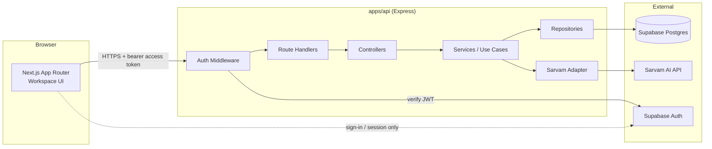
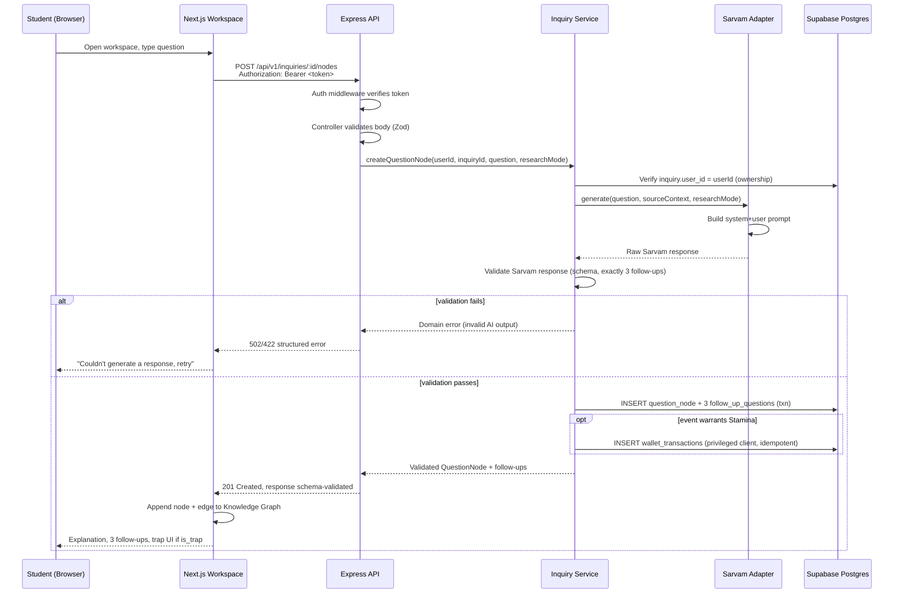
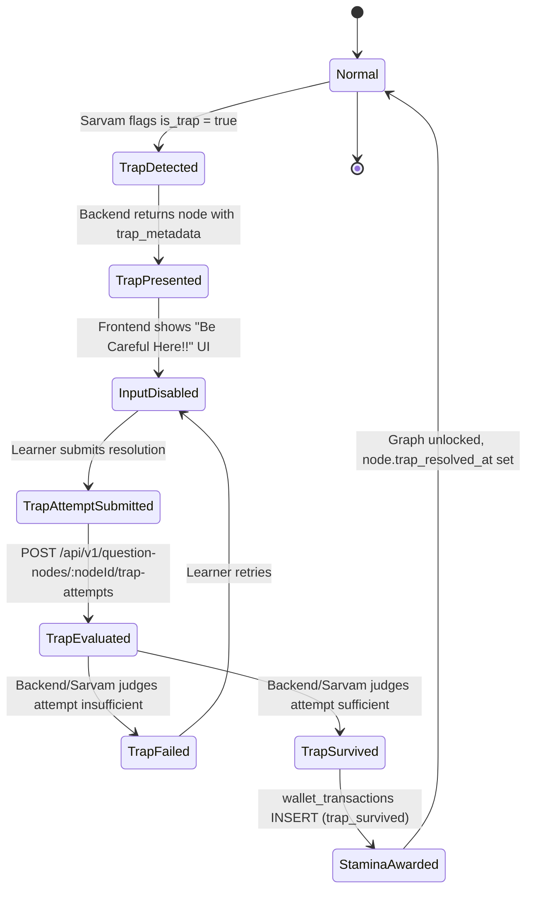
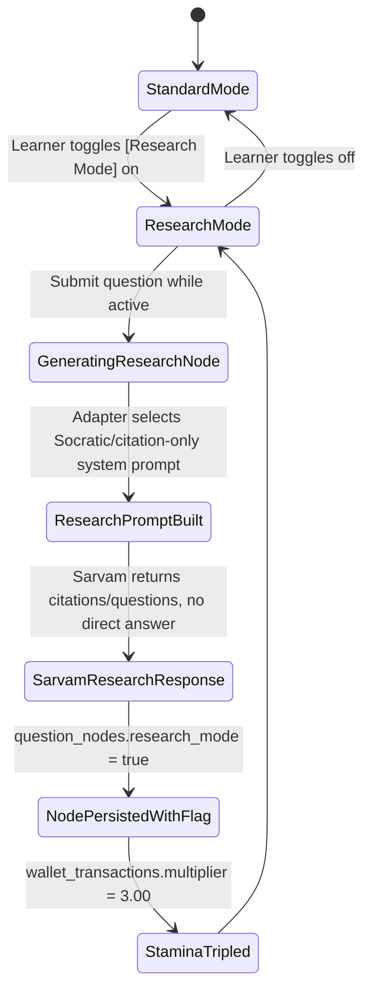

# Tattva — System Architecture

Status key: **Confirmed** (PRD or `CLAUDE.md`), **Proposed** (this document's recommendation), **Pending** (open product decision — do not implement silently).

Related: [DATABASE.md](DATABASE.md) · [API_CONTRACTS.md](API_CONTRACTS.md) · [ADR-001](decisions/ADR-001-system-architecture.md) · [ADR-002](decisions/ADR-002-authentication.md) · [ADR-003](decisions/ADR-003-database-model.md)

## 1. Overview

Tattva's hackathon MVP is a **modular monolith**: one Next.js frontend, one Express backend, one Supabase Postgres database, shared Zod/TypeScript contracts — no queues, no microservices, no extra infrastructure (`CLAUDE.md` §4, Confirmed). This document explains how the pieces fit together end-to-end for the Golden Path (`CLAUDE.md` §2).



The browser never calls Sarvam or holds Supabase service-role/secret credentials. It calls `apps/api` over HTTPS with a Supabase Auth access token; the backend verifies that token, then performs Sarvam calls and Supabase writes under its own trust boundary (`CLAUDE.md` §4, §5, Confirmed).

## 2. Frontend (`apps/web`)

| Component | Responsibility |
|---|---|
| **Workspace shell** | Split-screen 50/50 layout (PRD §3): source panel left, Knowledge Graph right. Owns top-level inquiry state and routes (`/inquiries/[id]`). |
| **Source material panel** | Renders the curated `learning_sources` content (video embed or parsed document) for the active inquiry. Read-only; no ingestion UI in the MVP. |
| **Knowledge Graph** | Renders `question_nodes` + edges via `@xyflow/react` (`CLAUDE.md` §4). Root node has no incoming edge; selecting a follow-up animates a new child node onto the canvas. Fetches the full node tree for an inquiry and re-fetches/append on each new node. |
| **Research Mode toggle** | Physical-looking switch (PRD §7). Toggling it (a) flips the UI to the high-contrast dark theme and (b) sets a `researchMode: boolean` flag sent with the next inquiry/question-node request — it does not itself call Sarvam or compute any multiplier; that's backend-only (Confirmed, `CLAUDE.md` invariant #5). |
| **Trap UI** | High-visibility "⚠️ Be Careful Here!!" component (PRD §5). Rendered when a `question_nodes` response has `is_trap = true`. Disables the normal question input and requires the learner to submit a trap-resolution response before the graph allows further branching (Proposed interaction detail — PRD specifies the state, not the exact UI flow). |
| **Stamina display** | Reads the derived balance from `GET /api/v1/stamina/me` ([API_CONTRACTS.md](API_CONTRACTS.md#6-get-apiv1staminame)) and renders it in the dashboard/workspace chrome. Never computes or caches a balance the user can edit client-side. |
| **Frontend API client** | A single typed client module wrapping `fetch`, attaching the Supabase access token as `Authorization: Bearer <token>`, validating responses against `packages/contracts` schemas before handing data to components. |

## 3. Backend (`apps/api`)

Layered, in request-flow order:

| Layer | Responsibility |
|---|---|
| **Express application** | HTTP server bootstrap, JSON body parsing, CORS (restricted to the known frontend origin, Confirmed per `CLAUDE.md` §5), centralized error-handling middleware, request logging with secrets redacted. |
| **Authentication middleware** | Extracts the bearer token, verifies it against Supabase Auth (ADR-002), attaches `{ userId, isAnonymous }` to the request context. Rejects missing/invalid/expired tokens with `401` before any route handler runs. |
| **Route handlers** | Thin Express routers mapping HTTP verb + path to a controller function. No business logic. |
| **Controllers** | Parse/validate the request against the matching `packages/contracts` Zod schema, call the relevant service, map the service result (or thrown domain error) to an HTTP response shape. No direct DB or Sarvam access. |
| **Services / use cases** | Own business rules: inquiry creation, question-node generation orchestration, trap handling, Stamina awarding. Coordinate the Sarvam adapter and repositories; enforce invariants (exactly 3 follow-ups, root-node uniqueness, idempotent Stamina writes) described in [DATABASE.md](DATABASE.md). |
| **Repositories** | Isolate Supabase Postgres access per entity (`InquiryRepository`, `QuestionNodeRepository`, `WalletTransactionRepository`, ...). Only repositories construct SQL/Supabase queries; services never embed raw queries. |
| **Sarvam integration adapter** | The only module that knows Sarvam's request/response shape, prompt construction, and provider-specific error handling. Translates Sarvam's raw output into Tattva's internal contract shape; everything above this layer only ever sees validated, internal types (`CLAUDE.md` §4). |
| **Supabase integration** | Two distinct Supabase clients: a **request-scoped client** using the caller's verified access token (used for ordinary, RLS-protected reads/writes), and a **privileged service-role client** used only inside the Stamina service for `wallet_transactions` writes (see §6). |

## 4. Shared contracts (`packages/contracts`)

- All request/response shapes crossing the `apps/web` ↔ `apps/api` boundary are defined once, as Zod schemas, with TypeScript types inferred via `z.infer<>` (`CLAUDE.md` §4, Confirmed).
- **Request validation**: controllers parse incoming bodies/params with the schema before any service call; a parse failure returns `400` with structured field errors ([API_CONTRACTS.md](API_CONTRACTS.md) response conventions).
- **Response validation**: services return data already shaped to the response schema; in development, controllers may additionally `parse()` the outgoing payload as a safety net against drift. The frontend client also validates responses before using them, treating the network boundary as untrusted even though both sides are "our" code.
- **AI output validation is a separate, additional schema layer**, owned by the Sarvam adapter, not the same schema as the public API response. Sarvam's raw output is parsed against a dedicated "Sarvam response" Zod schema first (checking for exactly 3 follow-ups, a boolean `is_trap`, non-empty explanation text); only after that passes is the data mapped into the public `QuestionNode` response contract. This two-step validation exists because Sarvam output is untrusted model output, while the public contract is Tattva's own API guarantee (`CLAUDE.md` §4: "Treat model output as untrusted").
- **Contract ownership**: `packages/contracts` is owned jointly, but changes must be announced before parallel frontend/backend implementation proceeds (`CLAUDE.md` §7), since both apps depend on it directly.

## 5. External integrations

| Integration | What it does | Owning layer |
|---|---|---|
| **Sarvam AI** | Generates the root/child explanation, exactly three adaptive follow-up questions, and the `is_trap` flag + trap scenario for a given question + source context; under Research Mode, generates citation/Socratic-style output instead of direct answers (PRD §7). | `apps/api` Sarvam adapter only. Never called from the browser (Confirmed). |
| **Supabase Auth** | Issues and verifies user sessions, including anonymous identities (ADR-002). Frontend obtains the session directly from Supabase Auth client-side (this is a normal, intended direct frontend↔Supabase-Auth interaction); the backend independently verifies the resulting access token on every authenticated request — it does not trust the frontend's claim of identity. | Session creation: frontend. Token verification: backend auth middleware. |
| **Supabase PostgreSQL** | Persistence for all five MVP entities ([DATABASE.md](DATABASE.md)). | `apps/api` repositories, via either the request-scoped or privileged client depending on the table (§6). |

## 6. Security architecture

### 6.1 Authentication verification
Every request to a protected `/api/v1/*` route must carry a Supabase Auth access token in `Authorization: Bearer <token>`. The auth middleware verifies the token's signature/expiry against Supabase (Confirmed — see [ADR-002](decisions/ADR-002-authentication.md) for the exact verification mechanism and anonymous-identity lifecycle). A request with no token, an expired token, or a token that fails verification is rejected with `401` before touching any service or repository.

### 6.2 Authorization
Resource ownership is enforced at two layers, intentionally overlapping:
1. **Database RLS** on `inquiries`, `question_nodes`, `follow_up_questions` (`USING (user_id = auth.uid())`, directly or via join — [DATABASE.md §10](DATABASE.md#10-rls-strategy)), when accessed through the request-scoped Supabase client.
2. **Service-layer checks** in `apps/api`: a service loads a resource and confirms `resource.userId === context.userId` before acting, regardless of what RLS would already prevent. This matters because the Stamina service uses a privileged client that **bypasses RLS entirely** for `wallet_transactions` writes — for that table, authorization is enforced by application code alone (see §6.3).

### 6.3 Service-role credentials vs. RLS — the critical boundary
`CLAUDE.md` §4 and §5 require the backend to use least-privilege, request-scoped database access for ordinary data, and narrowly restrict privileged service-role operations to trusted workflows. In this architecture:

- The **request-scoped Supabase client** (constructed per-request using the verified caller's access token) is used for all `inquiries`, `question_nodes`, `follow_up_questions`, and `learning_sources` reads/writes. RLS is the enforced guarantee here: even a bug in service-layer logic cannot leak or mutate another user's rows, because Postgres itself rejects it.
- The **privileged service-role client** is used **only** inside the Stamina service, to `INSERT` into `wallet_transactions`. RLS on that table grants the `authenticated` role **no** write access at all ([DATABASE.md §10](DATABASE.md#10-rls-strategy)) — so when the backend uses its service-role credential to write a ledger entry, **RLS is not the guarantee protecting that write; the Stamina service's own authorization and validation logic is**. Explicitly: the backend must verify (a) the request's `userId` matches the ledger entry's `user_id`, (b) the event actually occurred (e.g. the follow-up was genuinely just persisted, the trap was genuinely just resolved) before constructing the transaction, and (c) the idempotency key prevents replays. If this service-layer logic has a bug, RLS will not catch it for this table — this is a deliberate, narrowly-scoped trade-off (Confirmed rationale per `CLAUDE.md` §4), not an oversight.
- **The service-role/secret key itself never leaves `apps/api`.** It is read from server-only environment variables, never prefixed `NEXT_PUBLIC_*`, never sent to or embedded in any frontend bundle (Confirmed, `CLAUDE.md` §5).

### 6.4 User data isolation
Every table that stores per-user data carries (directly or via join) a `user_id` traceable to `auth.users.id`. No table combines two users' data in a way that requires cross-cutting filters beyond the RLS policies already documented in [DATABASE.md §10](DATABASE.md#10-rls-strategy).

### 6.5 Sarvam key protection
`SARVAM_API_KEY` lives only in `apps/api`'s server environment. The Sarvam adapter is the sole module that reads it; it is never logged, never included in error responses, and never reachable from any route that echoes request/response bodies verbatim.

### 6.6 Prompt injection considerations
The learner's raw question text is interpolated into the prompt sent to Sarvam. Mitigations (Proposed — finalize alongside the adapter implementation):
- Treat the system prompt (persona, Research Mode rules, trap-detection instructions) as the trusted, non-overridable instruction layer; the learner's question is data, not instruction, and the prompt template must make that separation explicit to the model.
- Never let the learner's input alter which system prompt variant is selected (Research Mode on/off is a server-side flag sourced from the node's own persisted `research_mode` state for that request, not re-derived from free text).
- Cap/sanitize input length before sending to Sarvam to limit prompt-stuffing attempts.
- Because the AI's output is re-validated by the backend schema (§4) regardless of what the model was tricked into producing, a successful prompt injection can at worst affect explanation content quality, not bypass the trap/follow-up/Stamina invariants that are enforced independently in code.

### 6.7 AI output validation
Covered in §4. No Sarvam output reaches the database or the frontend without passing the dedicated Sarvam-response Zod schema (shape, follow-up count, boolean fields). A validation failure is a handled error path (§7), not a silent pass-through with defaults invented by the backend.

### 6.8 Rate limiting
Proposed for the hackathon MVP: a lightweight per-user, per-IP rate limit (e.g. token-bucket middleware) on the inquiry/question-node creation routes, since each call incurs a Sarvam API cost and an anonymous-auth account is cheap to create repeatedly. Exact limits are Pending — not defined in the PRD; a conservative default (e.g. a handful of requests per minute) should be set and documented in `apps/api` configuration rather than invented ad hoc per route.

### 6.9 Stamina manipulation prevention
- Client never supplies `base_points`, `multiplier`, or `final_points` — the Stamina service computes all three server-side from the persisted `research_mode` state and the configured point table ([DATABASE.md §6](DATABASE.md#6-pending-product-decisions-do-not-guess)).
- `wallet_transactions` is insert-only at the database-role level ([DATABASE.md §11](DATABASE.md#11-append-only-ledger-strategy)).
- Every award is tied to a server-verified event (a node/follow-up/trap-resolution row that the backend itself just wrote in the same request), never to a bare client claim of "I did X."

### 6.10 Idempotency
Enforced via the `wallet_transactions.idempotency_key` unique constraint ([DATABASE.md §11](DATABASE.md#11-append-only-ledger-strategy)). The service layer treats a unique-violation on insert as "already awarded" and returns the existing transaction's effect rather than an error, so retried requests (network retry, double-click) cannot double-award.

### 6.11 Sensitive information in logs
Request/response logging middleware must redact `Authorization` headers, any Sarvam/Supabase key values, and raw learner PII beyond what's needed for debugging (Confirmed, `CLAUDE.md` §4, §5). Error responses returned to the client never include stack traces or internal query text in production.

## 7. Request lifecycle: submitting a technical question



Full lifecycle, stage by stage:

1. **Student opens a learning workspace.** `apps/web` loads the inquiry's source material and existing node tree via `GET /api/v1/inquiries/:inquiryId`.
2. **Student submits a technical question** (root question or a selected follow-up) from the workspace UI.
3. **Frontend sends an authenticated request** — `POST /api/v1/inquiries/:inquiryId/nodes` with the Supabase access token attached and `researchMode` reflecting the current toggle state.
4. **Backend verifies identity** — auth middleware confirms the token and resolves `userId`.
5. **Backend validates the request** — controller parses the body against the shared Zod schema; malformed input short-circuits with `400`.
6. **Inquiry service executes** — confirms the caller owns the target inquiry, then invokes the Sarvam adapter with the question, relevant source context, and Research Mode flag.
7. **Sarvam AI generates structured output** — explanation, exactly three follow-ups, and `is_trap` (+ trap data when applicable), shaped according to the prompt contract documented in the Sarvam adapter.
8. **Backend validates the AI response** — the dedicated Sarvam-response schema checks shape and the 3-follow-up invariant; failures are treated as a provider error, not silently patched (§7.1 failure handling).
9. **Database persists the question node and follow-up questions** — one transaction, per [DATABASE.md §11](DATABASE.md#11-append-only-ledger-strategy); partial failure rolls back entirely.
10. **Stamina transaction is created where applicable** — e.g. `followup_selected`, or `node_completed_research_mode` with the 3× multiplier, via the privileged client, with an idempotency key.
11. **Backend returns validated data** — the service's output is mapped to the public response contract and returned `201 Created`.
12. **Frontend updates the persistent Knowledge Graph** — the new node and edge are appended to the `@xyflow/react` canvas; if `is_trap` is true, the trap UI takes over input until resolved.

### 7.1 Failure handling at each stage

| Stage | Failure mode | Handling |
|---|---|---|
| Auth verification (4) | Missing/expired/invalid token | `401`, no service invoked |
| Request validation (5) | Malformed/missing fields | `400` with field-level errors from Zod |
| Ownership check (6) | Inquiry doesn't belong to caller, or doesn't exist | `404` (do not leak existence of other users' resources via `403`) |
| Sarvam call (7) | Timeout, rate limit, provider 5xx | `502 Bad Gateway` (or `503` for rate limiting) with a generic client message; the adapter logs the provider error without leaking the key; **no partial node is persisted** |
| AI output validation (8) | Wrong follow-up count, missing fields, unparseable JSON | Treated identically to a Sarvam call failure — `502`/`422`; optionally one bounded retry with a stricter re-prompt (Proposed), never a fabricated fallback follow-up invented by the backend |
| Persistence (9) | DB constraint violation, transaction failure | `500`, full rollback, no orphaned follow-ups or half-written nodes |
| Stamina write (10) | Idempotency conflict | Treated as success (already awarded), not surfaced as an error to the user |
| Stamina write (10) | Any other DB failure | The question-node write already committed in step 9 is **not** rolled back for a Stamina-write failure alone (the learning content is real regardless); the error is logged for reconciliation — Proposed, since the PRD doesn't specify this edge case explicitly |

## 8. Adversarial trap lifecycle



Notes:
- The exact grading mechanism for a trap attempt (re-invoke Sarvam to judge the explanation vs. a deterministic rubric) is **Pending** — the PRD states the behavior (forced resolution before proceeding, PRD §5) but not the grading implementation. Document the chosen approach as an ADR update once decided; do not assume a specific grading algorithm here.
- While `InputDisabled`, the standard question-input route should be considered logically blocked for that node's branch; the frontend enforces this via UI state, and the backend should still independently reject an attempt to create a new child node from a node whose trap is unresolved (`trap_resolved_at IS NULL`) — Proposed, since trusting only the frontend to block progression would violate `CLAUDE.md`'s "never trust the client" principle.

## 9. Research Mode lifecycle



Notes:
- `research_mode` is recorded per `question_node`, not just per-session, so historical nodes correctly reflect which mode produced them even if the learner toggles mid-session (Proposed, supports accurate Stamina auditing).
- The 3× multiplier (PRD §7, Confirmed) is applied by the Stamina service reading the just-persisted node's `research_mode` flag — never from a client-sent multiplier value (§6.9).

## 10. Hackathon Golden Path

The smallest complete working vertical slice, per `CLAUDE.md` §2:

```text
Technical Source → Inquiry → Sarvam AI → Structured Explanation →
Three Follow-up Questions → Persistent Knowledge Graph →
Research Mode → Adversarial Trap → Trap Completion → Verified Stamina Transaction
```

### 10.1 Minimum functionality
- One preselected `learning_sources` row (curated, ≥25-minute equivalent), seeded directly — no upload UI.
- Create an `inquiry` against that source for the signed-in (anonymous) user.
- Submit a root question → Sarvam explanation + exactly 3 follow-ups + `is_trap` flag.
- Render the root node and, on follow-up selection, a connected child node in `@xyflow/react`.
- Toggle Research Mode and observe both the UI theme change and the altered AI behavior on the next question.
- Trigger at least one deterministic trap scenario (a controlled demo fixture, per `CLAUDE.md` §4's "Sarvam integration" guidance, kept clearly separate from live Sarvam calls) and resolve it.
- Observe the Stamina display update after a follow-up selection, a trap survival, and a Research Mode node, including the visible 3× effect.

### 10.2 Required tables
`learning_sources`, `inquiries`, `question_nodes`, `follow_up_questions`, `wallet_transactions` — all five, per [DATABASE.md](DATABASE.md). No Tattva 200, Arena, or badge tables are required.

### 10.3 Required endpoints
All six endpoints in [API_CONTRACTS.md](API_CONTRACTS.md): `GET /health`, `POST /api/v1/inquiries`, `GET /api/v1/inquiries/:inquiryId`, `POST /api/v1/inquiries/:inquiryId/nodes`, `POST /api/v1/question-nodes/:nodeId/trap-attempts`, `GET /api/v1/stamina/me`.

### 10.4 Required UI components
Workspace shell, source panel, Knowledge Graph canvas, Research Mode toggle, trap alert component, Stamina display, question input, loading/empty/error states.

### 10.5 Required integrations
Supabase Auth (anonymous sign-in), Supabase Postgres (five tables above), Sarvam AI (explanation + follow-up + trap-detection calls; Research Mode variant).

### 10.6 Acceptance criteria
- A fresh anonymous session can complete the full Golden Path journey above without manual database intervention.
- Every `question_nodes` row with follow-ups has exactly 3 associated `follow_up_questions` rows — never fewer, never more.
- Toggling Research Mode visibly changes both the UI theme and the AI's response style, and the resulting node's Stamina award reflects the 3× multiplier.
- The trap UI blocks normal progression until explicitly resolved, and survival is reflected in both the graph (node state) and the Stamina ledger.
- The Knowledge Graph correctly shows parent→child edges after multiple follow-up selections across at least two levels of depth.
- No Sarvam or Supabase secret key is observable from browser dev tools, network tab response bodies, or frontend bundle source.

### 10.7 Failure scenarios to demonstrate resilience, not just the happy path
- Sarvam returns malformed/incomplete output → user sees a clear retry affordance, no broken node is persisted.
- Token expiry mid-session → user is prompted to re-authenticate (re-establish an anonymous session) without losing their existing persisted graph (data isolation by `user_id` keeps history intact once/if the same identity is restored — see [ADR-002](decisions/ADR-002-authentication.md) for the limitation this exposes with pure anonymous auth).
- Duplicate submit (double-click / network retry) on a follow-up selection does not double-create nodes or double-award Stamina.

### 10.8 Deterministic demo requirements
Per `CLAUDE.md` §4 and the PRD's "Kill-Shot" demo strategy (PRD §11): the trap scenario shown live to judges should use a **controlled demo fixture** — a specific, rehearsed input known to reliably trigger `is_trap = true` — rather than depending on live Sarvam non-determinism at the exact moment of a presentation. This fixture must be clearly separated in code from the live AI path (e.g. a seeded scenario or a verified-reliable prompt, not a hardcoded fake response presented as a live model result) so the distinction between "demonstrated reliably" and "faked" is explicit and honest, consistent with `CLAUDE.md`'s explicit prohibition on presenting a mock as a live result.

### 10.9 Explicitly deferred (not MVP)
Tattva 200 grid and unlock sequencing, public/shareable graphs and multiplayer branching, The Arena, "Conquered" badges and boss-fight nodes, CSS-grid thumbnail generator, full content ingestion pipeline, B2B recruiter dashboards/API — all per `CLAUDE.md` §2.

## 11. Document consistency checklist

- [x] API contracts ([API_CONTRACTS.md](API_CONTRACTS.md)) reference exactly the five domain entities modeled in [DATABASE.md](DATABASE.md).
- [x] The security model (§6) agrees with the authentication model described in [ADR-002](decisions/ADR-002-authentication.md) — token verification is the single trust boundary; no user ID is ever accepted bare from the client.
- [x] Every relationship in [DATABASE.md §8](DATABASE.md#8-relationships-and-cardinality) is referenced somewhere in the request lifecycle or Golden Path sections above.
- [x] All Mermaid diagrams use syntax consistent with the other diagrams in this document set (flowchart, sequenceDiagram, stateDiagram-v2, erDiagram).
