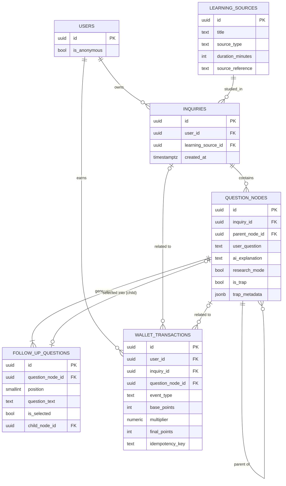

# Tattva — Database Architecture

Status key used throughout this document: **Confirmed** (stated in the PRD or `CLAUDE.md`), **Proposed** (this document's recommended design, not yet validated against the PRD), **Pending** (an explicit open product decision).

This document specifies the logical relational model for the hackathon MVP. It does not contain SQL migrations (see [ADR-003](decisions/ADR-003-database-model.md) for the decision record, and `supabase/migrations/` for the eventual versioned schema).

Related: [ARCHITECTURE.md](ARCHITECTURE.md) · [API_CONTRACTS.md](API_CONTRACTS.md) · [ADR-003](decisions/ADR-003-database-model.md)

## 1. Scope

Covers the five entities required for the Golden Path (`CLAUDE.md` §2): `learning_sources`, `inquiries`, `question_nodes`, `follow_up_questions`, `wallet_transactions`. Entities described in the PRD but explicitly deferred for the hackathon (Tattva 200 catalog/progress, Arena submissions/votes, badges, thumbnail metadata) are **not modeled here** — see §15.

## 2. Entity descriptions

### A. `learning_sources` — Confirmed scope, Proposed schema
Curated technical learning material a student studies against. The hackathon uses a small, pre-curated set (`CLAUDE.md` §2); there is no ingestion pipeline. The PRD's 25-minute minimum (PRD §2) is enforced as a check constraint at insert time, since all rows are created by the team, not by end users, during the hackathon.

### B. `inquiries` — Confirmed
A learner's persistent workspace against one `learning_source`. Corresponds to the PRD's "Knowledge Scaffold" session (PRD §3) — the root of one semantic tree.

### C. `question_nodes` — Confirmed
A single question + AI explanation pair inside an inquiry's tree. Supports the root/child branching model, Research Mode state, and trap state (PRD §3, §5, §7).

### D. `follow_up_questions` — Confirmed
Exactly three adaptive follow-ups per node (PRD §3, `CLAUDE.md` invariant #2). Selecting one creates a new child `question_node`; the row records which follow-up produced which child.

### E. `wallet_transactions` — Confirmed
The append-only Cognitive Stamina ledger (PRD §10). Server-authored only; immutable at the application level.

## 3. Table definitions (logical level)

### 3.1 `learning_sources`

| Column | Type | Notes |
|---|---|---|
| `id` | `uuid`, PK, default `gen_random_uuid()` | Source identity |
| `title` | `text`, not null | |
| `description` | `text`, not null | |
| `source_type` | `text`, not null | Proposed enum: `'video'` \| `'document'` \| `'transcript'` — Pending final list |
| `duration_minutes` | `integer`, not null | Reading/runtime equivalent. Check: `duration_minutes >= 25` (PRD §2) |
| `source_reference` | `text`, not null | URL or storage pointer to the curated material |
| `published_at` | `timestamptz`, nullable | Publication metadata |
| `created_at` | `timestamptz`, not null, default `now()` | |

**Primary key:** `id`.
**Check constraints:** `duration_minutes >= 25`.
**Unique constraints:** none required for the hackathon (curated, low-volume, inserted manually/by seed script).

### 3.2 `inquiries`

| Column | Type | Notes |
|---|---|---|
| `id` | `uuid`, PK, default `gen_random_uuid()` | |
| `user_id` | `uuid`, not null, FK → `auth.users.id` | Canonical identity (ADR-002) |
| `learning_source_id` | `uuid`, not null, FK → `learning_sources.id` | |
| `title` | `text`, nullable | Optional display label, defaults to source title |
| `created_at` | `timestamptz`, not null, default `now()` | |
| `updated_at` | `timestamptz`, not null, default `now()` | Bumped on new node creation (trigger or application code) |

**Primary key:** `id`.
**Foreign keys:** `user_id → auth.users.id` (`ON DELETE CASCADE`), `learning_source_id → learning_sources.id` (`ON DELETE RESTRICT`).
**Indexes:** `(user_id)`, `(user_id, created_at desc)` for dashboard listing.

### 3.3 `question_nodes`

| Column | Type | Notes |
|---|---|---|
| `id` | `uuid`, PK, default `gen_random_uuid()` | |
| `inquiry_id` | `uuid`, not null, FK → `inquiries.id` | |
| `parent_node_id` | `uuid`, nullable, FK → `question_nodes.id` | `NULL` ⇒ root node |
| `user_question` | `text`, not null | Learner's input question |
| `ai_explanation` | `text`, not null | Sarvam-generated explanation, post-validation |
| `research_mode` | `boolean`, not null, default `false` | Mode active when this node was generated (PRD §7) |
| `is_trap` | `boolean`, not null, default `false` | AI-flagged adversarial state (PRD §5) |
| `trap_metadata` | `jsonb`, nullable | Structured trap scenario (e.g. misconception type, scenario text) — Proposed shape in §4 |
| `trap_resolved_at` | `timestamptz`, nullable | Set when the learner completes the forced trap step — Proposed |
| `created_at` | `timestamptz`, not null, default `now()` | |

**Primary key:** `id`.
**Foreign keys:** `inquiry_id → inquiries.id` (`ON DELETE CASCADE`), `parent_node_id → question_nodes.id` (`ON DELETE CASCADE`, self-referencing).
**Check constraints:** `parent_node_id IS NULL OR parent_node_id <> id` (no self-parenting).
**Indexes:** `(inquiry_id)`, `(parent_node_id)` for tree traversal, partial index `(inquiry_id) WHERE parent_node_id IS NULL` to find the root quickly.

**Root node invariant (Proposed):** exactly one node per `inquiry_id` has `parent_node_id IS NULL`. Enforced at the application/service layer (the "first node created for an inquiry" rule) rather than a DB constraint, because a DB-level unique-partial-index approach is viable but the service layer already owns node-creation sequencing — see §11 for the recommended enforcement point.

### 3.4 `follow_up_questions`

| Column | Type | Notes |
|---|---|---|
| `id` | `uuid`, PK, default `gen_random_uuid()` | |
| `question_node_id` | `uuid`, not null, FK → `question_nodes.id` | The node that generated this follow-up |
| `position` | `smallint`, not null | `1`, `2`, or `3` |
| `question_text` | `text`, not null | |
| `is_selected` | `boolean`, not null, default `false` | Selection status |
| `child_node_id` | `uuid`, nullable, FK → `question_nodes.id` | Set once the learner selects it and a child node is created |
| `created_at` | `timestamptz`, not null, default `now()` | |

**Primary key:** `id`.
**Foreign keys:** `question_node_id → question_nodes.id` (`ON DELETE CASCADE`), `child_node_id → question_nodes.id` (`ON DELETE SET NULL`).
**Unique constraints:** `UNIQUE (question_node_id, position)` — prevents duplicate positions.
**Check constraints:** `position IN (1, 2, 3)`.
**Application-level constraint (Proposed):** a `question_node` is not considered "complete" until it has exactly 3 associated `follow_up_questions` rows. This cannot be a single-table DB constraint (it's a cross-row count); enforce it transactionally in the service that persists the Sarvam response — insert the parent node and all 3 follow-ups in one DB transaction, or insert none. See §11.

### 3.5 `wallet_transactions`

| Column | Type | Notes |
|---|---|---|
| `id` | `uuid`, PK, default `gen_random_uuid()` | Transaction ID |
| `user_id` | `uuid`, not null, FK → `auth.users.id` | |
| `inquiry_id` | `uuid`, nullable, FK → `inquiries.id` | Related inquiry, if applicable |
| `question_node_id` | `uuid`, nullable, FK → `question_nodes.id` | Related node, if applicable |
| `event_type` | `text`, not null | Proposed enum, see §5 |
| `base_points` | `integer`, not null | Pending exact values — see §6 |
| `multiplier` | `numeric(4,2)`, not null, default `1.00` | `3.00` under Research Mode (PRD §7, Confirmed) |
| `final_points` | `integer`, not null | `base_points * multiplier`, computed server-side before insert |
| `idempotency_key` | `text`, not null | Proposed format: `{user_id}:{event_type}:{question_node_id}` or request-supplied UUID — see §6 |
| `metadata` | `jsonb`, nullable | Free-form context (e.g. trap id, follow-up position) |
| `created_at` | `timestamptz`, not null, default `now()` | |

**Primary key:** `id`.
**Foreign keys:** `user_id → auth.users.id` (`ON DELETE CASCADE`), `inquiry_id → inquiries.id` (`ON DELETE SET NULL`), `question_node_id → question_nodes.id` (`ON DELETE SET NULL`).
**Unique constraints:** `UNIQUE (idempotency_key)` — the primary duplicate-award defense.
**Check constraints:** `final_points = base_points * multiplier` (Proposed — enforceable as a `CHECK`, or computed and trusted at the application layer if rounding semantics make the DB check brittle; recommend the DB check for a hard guarantee), `base_points >= 0`, `multiplier > 0`.
**No `UPDATE`/`DELETE` grants** for the application's database role on this table beyond `INSERT`/`SELECT` — see §11.

## 4. `trap_metadata` shape (Proposed, pending UX finalization)

```json
{
  "misconception_type": "race_condition | deadlock | memory_safety | ...",
  "scenario": "string describing the adversarial edge case presented to the learner",
  "resolution_required": true
}
```

This is a Proposed shape only; the PRD does not define the exact trap data contract. The authoritative shape lives in `packages/contracts` (Zod schema) once implementation begins — this table documents intent, not the source of truth for validation.

## 5. `wallet_transactions.event_type` values (Proposed)

| Value | Trigger | PRD reference |
|---|---|---|
| `inquiry_started` | Student initiates a study session | PRD §10 |
| `followup_selected` | Learner selects a deep-dive follow-up | PRD §3, §10 |
| `trap_survived` | Learner completes a "Be Careful Here!!" trap | PRD §5, §10 |
| `node_completed_research_mode` | Node completed while Research Mode is active (3× multiplier applies) | PRD §7 |

This list is Proposed and intentionally minimal for the Golden Path. The PRD references other Stamina-triggering events (Tattva 200 completion, Arena bounties, "Conquered" badges) that are out of scope for the hackathon (`CLAUDE.md` §2) and therefore not modeled.

## 6. Pending product decisions (do not guess)

- **Exact Stamina point values** (`base_points` per `event_type`) are not defined anywhere in the PRD. They must not be invented here. Record them as a product decision before implementation; until then, treat `base_points` as a server-side configuration constant, not a hardcoded literal per call site.
- **Idempotency key construction.** The PRD requires duplicate-award prevention but does not specify the mechanism. Proposed: the backend derives a deterministic key per logical event (e.g. `followup_selected` can only be awarded once per `follow_up_questions.id`), and/or the frontend supplies a request-scoped idempotency key that the backend validates. Finalize in `ADR-003` once the Stamina service is designed.

## 7. Total Stamina balance calculation

A user's Cognitive Stamina balance is **derived, not stored**:

```sql
SELECT COALESCE(SUM(final_points), 0) AS stamina_balance
FROM wallet_transactions
WHERE user_id = $1;
```

Rationale: storing a mutable running balance on the `auth.users`-linked profile would reintroduce a client- or race-condition-editable single point of truth. Deriving the balance from the immutable ledger preserves the PRD's "un-fakeable ledger" guarantee (PRD, Philosophical Core). For the hackathon's data volume this aggregate query is cheap; a materialized balance (see §14) is a future optimization, not a current requirement.

## 8. Relationships and cardinality

| Relationship | Cardinality | Enforcement |
|---|---|---|
| `auth.users` → `inquiries` | 1 : N | FK `inquiries.user_id` |
| `learning_sources` → `inquiries` | 1 : N | FK `inquiries.learning_source_id` |
| `inquiries` → `question_nodes` | 1 : N | FK `question_nodes.inquiry_id` |
| `question_nodes` → `question_nodes` (self) | 1 : N (parent → children) | FK `question_nodes.parent_node_id` |
| `question_nodes` → `follow_up_questions` | 1 : exactly 3 (once complete) | FK + unique `(question_node_id, position)` + application transaction (§3.4) |
| `follow_up_questions` → `question_nodes` (child) | 1 : 0..1 | FK `follow_up_questions.child_node_id` |
| `auth.users` → `wallet_transactions` | 1 : N | FK `wallet_transactions.user_id` |
| `inquiries` / `question_nodes` → `wallet_transactions` | 0..1 : N | nullable FKs |

## 9. Mermaid ER diagram



## 10. RLS strategy

See [ARCHITECTURE.md §6 Security Architecture](ARCHITECTURE.md#6-security-architecture) for the full rationale on the interaction between RLS and service-role credentials. Summary:

- **`auth.users`** is managed entirely by Supabase Auth; the application never writes to it directly.
- **`learning_sources`**: `SELECT` allowed for any authenticated (including anonymous) role — `USING (auth.role() = 'authenticated')`. No `INSERT`/`UPDATE`/`DELETE` policy for the browser; curated content is seeded via privileged backend/migration tooling only.
- **`inquiries`**, **`question_nodes`**, **`follow_up_questions`**: `SELECT`/`INSERT` policies scoped to `USING (user_id = auth.uid())` / `WITH CHECK (user_id = auth.uid())` (directly on `inquiries`; on `question_nodes`/`follow_up_questions` via a join back to the owning `inquiries.user_id`, since those tables don't carry `user_id` directly). No `UPDATE`/`DELETE` policy for ordinary users in the MVP — nodes are immutable once created (Proposed; revisit if editing is added later).
- **`wallet_transactions`**: `SELECT` policy `USING (user_id = auth.uid())` so a user can read their own balance/history. **No `INSERT`/`UPDATE`/`DELETE` policy for the `authenticated` role at all** — all ledger writes happen through the backend's privileged (service-role) connection, inside a trusted service method, never via a user-scoped Supabase client. This is the one table where RLS intentionally grants zero direct write access to end users; see ARCHITECTURE.md for why this is safe only because the backend enforces authorization before using its privileged credential.

**Design principle (Confirmed, from `CLAUDE.md` §4):** prefer request-scoped, user-authorized database operations for ordinary reads/writes, and narrowly restrict privileged service-role operations to the Stamina ledger and any other explicitly trusted workflow.

## 11. Append-only ledger strategy

1. **Database role permissions.** The Postgres role used for the backend's privileged Supabase client is granted `INSERT`, `SELECT` on `wallet_transactions` only — not `UPDATE` or `DELETE`. This is enforced at the role/grant level, not just by application discipline, so a code bug cannot silently mutate history.
2. **No soft-delete, no correction rows that overwrite.** A mistaken award is corrected by inserting a new, clearly-tagged compensating transaction (e.g. `event_type = 'correction'`, negative `final_points`), never by editing the original row. This is Proposed since the hackathon scope may never need corrections, but the rule should hold from day one so the ledger's audit guarantee is never informally violated.
3. **Idempotency enforced at the database** via `UNIQUE (idempotency_key)` — a retried request or a race between two tabs produces a unique-constraint violation that the service layer treats as "already awarded," not an error surfaced to the user.
4. **Multiplier application is server-only.** The value of `research_mode` used to decide the 3× multiplier is read from the `question_nodes` row the backend itself just persisted in the same transaction — never trusted from client-supplied request fields at the point of awarding Stamina.
5. **Node + follow-up transactional integrity.** Because a `question_node` is only "complete" with exactly 3 `follow_up_questions`, the service layer wraps `INSERT question_nodes` + `INSERT follow_up_questions ×3` (+ the related `wallet_transactions` row, where applicable) in a single database transaction. A partial failure (e.g. Sarvam returned 2 follow-ups after validation) rolls back the whole write — the API returns an error rather than persisting an incomplete node (see ARCHITECTURE.md §5 failure handling).

## 12. Data ownership boundaries

| Table | Owning layer | Written by |
|---|---|---|
| `learning_sources` | Content curation (hackathon: Member 4 / seed script) | Privileged backend tooling / migration seed only |
| `inquiries` | `apps/api` inquiry service | Backend, on behalf of the authenticated user |
| `question_nodes` | `apps/api` inquiry service | Backend only, after validating Sarvam output |
| `follow_up_questions` | `apps/api` inquiry service | Backend only, in the same transaction as the parent node |
| `wallet_transactions` | `apps/api` stamina service | Backend only, privileged connection, never user-scoped |

The browser never writes directly to any of these tables from the client, even where RLS would technically allow a `SELECT`. All product writes go through `apps/api` (`CLAUDE.md` §4 request flow), which keeps `packages/contracts` validation and business rules in one place.

## 13. Referential integrity

- All foreign keys above are `NOT NULL` unless explicitly marked nullable.
- `ON DELETE CASCADE` is used where the child record is meaningless without its parent (`inquiries` under a user, `question_nodes` under an inquiry, `follow_up_questions` under a node) — deleting a user or an inquiry cleanly removes their owned tree.
- `ON DELETE RESTRICT` on `inquiries.learning_source_id` prevents deleting a `learning_sources` row that still has active inquiries referencing it (curated content shouldn't disappear under active learners).
- `ON DELETE SET NULL` is used on `wallet_transactions`' optional references and `follow_up_questions.child_node_id`, so the ledger and a pre-selection follow-up row survive even if the referenced node is later removed — the ledger must never cascade-delete, since that would break the audit trail.

## 14. Expected query patterns

| Pattern | Query shape | Index support |
|---|---|---|
| Load a user's inquiry list (dashboard) | `WHERE user_id = $1 ORDER BY created_at DESC` | `(user_id, created_at DESC)` on `inquiries` |
| Load a full Knowledge Graph for one inquiry | `WHERE inquiry_id = $1` then reconstruct tree in-memory from `parent_node_id` | `(inquiry_id)` on `question_nodes` |
| Find a node's 3 follow-ups | `WHERE question_node_id = $1 ORDER BY position` | `(question_node_id, position)` unique index |
| Compute Stamina balance | `SELECT SUM(final_points) WHERE user_id = $1` | `(user_id)` on `wallet_transactions` |
| Stamina history (audit view) | `WHERE user_id = $1 ORDER BY created_at DESC` | `(user_id, created_at DESC)` |
| Idempotency check before insert | `WHERE idempotency_key = $1` | unique index (also serves as lookup index) |

## 15. Future scalability considerations (out of MVP scope)

- **Tattva 200 catalog & progress.** Will require a `concept_nodes` (curriculum catalog) table plus a `user_concept_progress` join table tracking unlock/completion state per user — deferred per `CLAUDE.md` §2.
- **Arena submissions & voting.** Will require `arena_challenges`, `arena_submissions`, and a weighted-vote table keyed off Stamina percentile at vote time — deferred.
- **"Conquered" badges.** Will likely be a `badges` table referencing `question_nodes` or concept nodes, plus public-share tokens — deferred.
- **Materialized Stamina balance.** If `wallet_transactions` grows large enough that `SUM()` on every read becomes costly, introduce a maintained summary table/materialized view refreshed by the same trusted backend code path that writes the ledger — never a client-writable balance column.
- **Public/shareable graphs.** The PRD's multiplayer graph-branching feature (PRD §3) will need a distinct "public read" RLS policy class, separate from the current fully-private-per-user model — explicitly deferred for the hackathon (`CLAUDE.md` §2).
